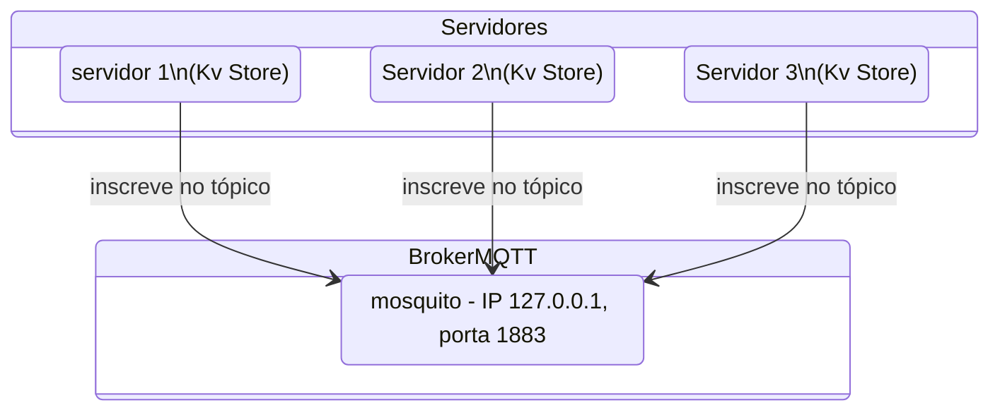
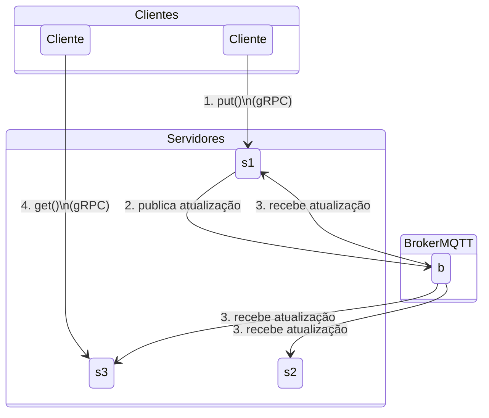

# Projeto: Servidor de Armazenamento Chave-Valor Distribuído com Consistência Eventual

## Objetivo

O objetivo deste projeto é implementar o servidor, ou nó, de **Armazenamento Chave-Valor Distribuído, eventualmente consistente**. 
Este nó será capaz de:

1.  Atender requisições de `Put` e `Get` de clientes via **gRPC**.
2.  Manter a consistência dos dados com outros nós no cluster através de **replicação via MQTT**, utilizando **Vector Clocks** para resolução de conflitos.

O foco será na implementação da lógica central para armazenamento de dados, gerenciamento de consistência e comunicação entre nós, demonstrando uma compreensão dos fundamentos de sistemas distribuídos sem a necessidade de gerenciar a associação ao cluster ou algoritmos de consenso complexos.

## Visão Geral da Arquitetura

Cada nó no armazenamento Chave-Valor distribuído opera de forma independente, mas se comunica com outros nós para alcançar a consistência eventual.

* **Comunicação Cliente-Nó (gRPC):** Clientes interagem com qualquer nó no cluster usando gRPC para realizar operações de `Put` (escrita) e `Get` (leitura).
* **Comunicação Nó-Nó (MQTT):** Os nós usam um *broker* MQTT para difundir atualizações (replicar dados) para todos os outros nós inscritos. Isso permite uma propagação de dados assíncrona e desacoplada.

**Diagrama Conceitual:**

  - Servidores se subscrevem para receber atualizações.
  


  - Clientes fazem requisições a servidores individuais.
  - Atualizações são publicadas e entregues a todos os servidores pelo _Broker_.
 


## Estruturas de Dados

O armazenamento chave-valor irá guardar dados de forma que permita que múltiplas versões concorrentes do valor de uma chave e seu histórico causal sejam rastreados.

1.  **`VectorClock`**:
    * **Tipo:** Um mapa/dicionário onde as chaves são `NodeID` (string) e os valores são `Counter` (inteiro de 64 bits sem sinal).
    * **Propósito:** Rastreia o histórico causal de um dado. Cada entrada `(NodeID, Counter)` indica que esta versão do dado viu todas as atualizações de `NodeID` até o `Counter` especificado.

2.  **`Version`**:
    * **Tipo:** Uma estrutura/objeto que representa uma única versão de um valor para uma dada chave.
    * **Campos:**
        * `value`: String (o dado real armazenado).
        * `vector_clock`: `VectorClock` (o *vector clock* associado a esta versão específica).
        * `timestamp`: Inteiro de 64 bits sem sinal (nanosegundos desde a Época Unix quando esta versão foi criada). Usado como desempate para versões concorrentes.
        * `writer_node_id`: String (o `NodeID` do nó que originalmente escreveu esta versão).

3.  **`StoreEntry`**:
    * **Tipo:** Uma estrutura/objeto que representa todas as versões ativas para uma chave específica.
    * **Campos:**
        * `key`: String (a chave para a qual os valores estão armazenados).
        * `versions`: Lista/Array de objetos `Version` (contém todas as versões atualmente ativas e não substituídas para esta chave).

4.  **`NodeState`**:
    * **Tipo:** O objeto de estado central para um único nó.
    * **Campos:**
        * `node_id`: String (Um identificador único para este nó).
        * `store`: Um mapa/dicionário concorrente que mapeia chaves para seus objetos `StoreEntry`.


## Algoritmos

O núcleo do modelo de consistência reside em como os `VectorClock`s são gerenciados e como as operações de `Put` e `Get` interagem com eles.

1.  **`merge_vector_clocks(vc1, vc2)`**:
    * **Entrada:** Dois `VectorClock`s, `vc1` e `vc2`.
    * **Saída:** Um novo `VectorClock`. 
        * Para cada `NodeID` presente em `vc1` ou `vc2`, o *clock* mesclado assume o valor máximo do contador. Se um `NodeID` estiver presente apenas em um *clock*, seu contador é assumido diretamente.
    * **Exemplo:**
        * `vc1 = {A:1, B:2}`
        * `vc2 = {A:2, C:1}`
        * `merged = {A:2, B:2, C:1}`

2.  **`compare_vector_clocks(vc1, vc2)`**:
    * **Entrada:** Dois `VectorClock`s, `vc1` e `vc2`.
    * **Saída:**
        * `true` se `vc1` aconteceu antes de `vc2` (ou seja, `vc1` é estritamente menor ou igual a `vc2` em todos os componentes, e estritamente menor em pelo menos um, ou `vc2` tem componentes que não estão em `vc1`).
        * `false` se `vc2` aconteceu antes de `vc1` (simétrico a `true`).
        * `null`/`None` se `vc1` e `vc2` forem concorrentes (nenhum aconteceu antes do outro).

3.  **`process_put(key, new_version_value, is_replication_source)`**:
    * **Entrada:** `key` (string), `new_version_value` (string), `is_replication_source` (booleano - `true` se este PUT for de uma mensagem de replicação MQTT, `false` se for de um cliente gRPC).
    * **Saída:** `void` (ou erro indicando falha).
    * **Lógica:**
        a.  **Criar nova versão para inclusão:**
            * Se `!is_replication_source` (ou seja, PUT iniciado pelo cliente):
                * adicione os valores adequados para `timestamp` e o `writer_node_id`.
                * atualize o **Vector Clock** para a chave, fazendo *merge* com o valor anterior, caso necessário.
            * Caso contrário (`is_replication_source`):
                * O objeto `new_version` recebido já conterá seu `timestamp`, `writer_node_id` e `vector_clock`. Use-os diretamente.

        b.  **Resolução de Conflitos / Gerenciamento de Versões:**
            * A nova versão obtida deverá substituir qualquer versão precedente no `StoreEntry` do `store`.
            * Caso a nova versão seja concorrente com alguma versão no `store`, ambas deverão ser mantidas no `StoreEntry`.
                * Compare os **vector clocks** para saber se há ou não concorrência entre as versões.
            * Não deve haver versões repetidas para a mesma chave no `StoreEntry`. 
            

        c.  **Replicar (se não for fonte de replicação):**
            * Se `!is_replication_source` (ou seja, este PUT originou-se de um cliente neste nó):
                * Serialize o `StoreEntry` atualizado em uma string JSON.
                * Publique esta string JSON no tópico MQTT `kvstore/replication` com **QoS 1 (AtLeastOnce)**. Isso garante que outros nós recebam a atualização.
                * Esta publicação deve ocorrer de forma assíncrona (ex: em uma *thread*/`goroutine`/tarefa separada) para evitar bloquear a resposta gRPC.

4.  **`process_get(key)`**:
    * **Entrada:** `key` (string).
    * **Saída:** Lista/Array de objetos `Version` (ou lista vazia se a chave não for encontrada).
    * **Lógica:**
        a.  Recupere o `StoreEntry` para `key`. Se não for encontrado, retorne uma lista vazia.
        b.  Retorne apenas os objetos `Version`s ativos, ou seja, versões concorrentes ou versões que não precedem nenhum outra versão ativa.


## Protocolos de Comunicação

1.  **API gRPC (`kv_store.proto`)**:
    Deve-se usar, **obrigatoriamente**, a seguinte definição `.proto` para gerar o código do cliente (previamente fornecido) e do servidor para a linguagem escolhida.

    ```protobuf
    syntax = "proto3";

    package kvstore;

    // O principal serviço de armazenamento chave-valor
    service KvStore {
      // Armazena um par chave-valor. Aciona a replicação para outros nós.
      rpc Put (PutRequest) returns (PutResponse);
      // Recupera todas as versões ativas para uma dada chave.
      rpc Get (GetRequest) returns (GetResponse);
    }

    // --- Estruturas de Dados ---

    // Representa uma única entrada em um Vector Clock.
    message VectorClockEntry {
      string node_id = 1;
      uint64 counter = 2;
    }

    // Um Vector Clock, representado como uma lista de entradas.
    message VectorClock {
      repeated VectorClockEntry entries = 1;
    }

    // Representa uma versão específica de um valor para uma chave.
    message Version {
      string value = 1;
      // O vector clock associado a esta versão. Opcional para flexibilidade.
      VectorClock vector_clock = 2;
      uint64 timestamp = 3; // Nanosegundos desde a época Unix.
      string writer_node_id = 4; // O ID do nó que originalmente escreveu esta versão.
    }

    // --- Mensagens de Requisição ---

    // Requisição para a operação Put.
    message PutRequest {
      string key = 1;
      string value = 2;
    }

    // Requisição para a operação Get.
    message GetRequest {
      string key = 1;
    }

    // --- Mensagens de Resposta ---

    // Resposta para a operação Put.
    message PutResponse {
      bool success = 1;
      string error_message = 2;
    }

    // Resposta para a operação Get.
    message GetResponse {
      repeated Version versions = 1; // Todas as versões ativas encontradas para a chave.
      string error_message = 2;
    }
    ```

2.  **API MQTT**:
    * **Broker:** Qualquer *broker* MQTT padrão (ex: Mosquitto) pode ser usado.
    * **Tópico:** `kvstore/replication`
    * **Payload:** Quando um nó origina uma requisição `Put` (ou seja, `is_replication_source` é `false` em `process_put`), ele deve serializar o `StoreEntry` completo (não apenas a `Version`) para JSON e publicá-lo neste tópico.
    * **Qualidade de Serviço (QoS):** **QoS 1 (AtLeastOnce)** deve ser usado para publicação e assinatura para garantir que as mensagens sejam entregues.


## Detalhes da Implementação do Servidor

1.  **Argumentos de Linha de Comando**:
    O servidor deve aceitar os seguintes argumentos de linha de comando:
    * `--node-id <ID>`: Um identificador de string único para este nó (ex: `node_A`, `node_B`). Se não for fornecido, gere um UUID.
    * `--listen-addr <ADDRESS>`: O endereço IP e a porta onde o servidor gRPC irá escutar (ex: `127.0.0.1:50051`).
    * `--mqtt-broker-addr <ADDRESS>`: O endereço IP do *broker* MQTT. Se não for fornecido, utilize `127.0.0.1`.
    * `--mqtt-broker-port <PORT>`: A porta do *broker* MQTT. Se não for fornecida, utilize `1883`.

2.  **Gerenciamento de Concorrência**:
    * O `store` do `NodeState` deve ser *thread-safe*. Use primitivas de sincronização apropriadas para sua linguagem (ex: `Mutex` em Rust, `sync.Mutex`/`sync.RWMutex` em Go, `threading.Lock` para um dicionário em Python, `ConcurrentHashMap` em Java).
    * A publicação MQTT deve ser geralmente não bloqueante ou assíncrona da *thread* de tratamento de requisições gRPC.

3.  **Fluxo Lógico Principal do Servidor**:
    * Analisar os argumentos de linha de comando.
    * Inicializar a conexão do cliente MQTT com o *broker* especificado.
    * Criar uma instância de `NodeState`.
    * **Disparar uma Tarefa/Thread de Escuta MQTT:** Esta unidade concorrente separada irá:
        * Assinar o tópico `kvstore/replication`.
        * Continuamente buscar por mensagens MQTT recebidas.
        * Quando uma mensagem no `kvstore/replication` for recebida:
            * Desserializar o *payload* JSON de volta para um objeto `StoreEntry`.
            * Para cada `Version` dentro do `StoreEntry` desserializado, chamar `process_put(key, version, true)` (importante: `is_replication_source` deve ser `true`).
    * **Iniciar o Servidor gRPC:** Isso exporá os métodos `Put` e `Get` aos clientes.
        * O método gRPC `Put` chamará `process_put(key, value, false)`.
        * O método gRPC `Get` chamará `process_get(key)`.


## Requisitos do projeto

1.  **Implementar Estruturas de Dados Essenciais:** Traduza `VectorClock`, `Version` e `StoreEntry` para classes/estruturas na linguagem escolhida.
2.  **Implementar Algoritmos de Vector Clock:** Implemente `merge_vector_clocks` e `compare_vector_clocks` corretamente.
3.  **Implementar `process_put`:** Esta é a parte mais crítica para a consistência. Garanta que ela lide com atualizações de *vector clock*, resolução de conflitos e replicação MQTT condicional.
4.  **Implementar `process_get`:** Garanta que ela retorne apenas versões ativas com base nas comparações de *vector clock*.
5.  **Implementação do Servidor gRPC:**
    * Use o arquivo `.proto` fornecido para gerar o código necessário.
    * Implemente o serviço `KvStore` com os RPCs `Put` e `Get`.
    * Integre com seu `NodeState` para chamar `process_put` e `process_get`.
6.  **Integração do Cliente MQTT:**
    * Use uma biblioteca de cliente MQTT adequada para sua linguagem.
    * Configure uma tarefa/thread em segundo plano para assinar `kvstore/replication`.
    * Implemente a lógica para desserializar e processar mensagens de replicação recebidas.
    * Implemente a lógica para serializar e publicar objetos `StoreEntry` após operações `Put` iniciadas pelo cliente.
7.  **Análise de Argumentos de Linha de Comando:** Implemente a análise de argumentos para `node-id`, `listen-addr`, `mqtt-broker-addr` e `mqtt-broker-port`.


## Sugestões de bibliotecas por linguagem

* **Java:**
    * **gRPC:** Use `grpc-java`.
    * **MQTT:** Use Eclipse Paho MQTT Client.
    * **Concorrência:** `java.util.concurrent.ConcurrentHashMap` para `store`, blocos `synchronized` ou `ReentrantLock` para travamento mais granular se necessário, `ExecutorService` para tarefas em segundo plano.
    * **JSON:** Jackson ou Gson para serialização/desserialização de `StoreEntry`.
* **Go:**
    * **gRPC:** Use `google.golang.org/grpc`.
    * **MQTT:** Use `github.com/eclipse/paho.mqtt.golang`.
    * **Concorrência:** `sync.Mutex` ou `sync.RWMutex` para `store`, `go` routines para tarefas concorrentes.
    * **JSON:** Pacote `encoding/json`.
* **Python:**
    * **gRPC:** Use `grpcio`.
    * **MQTT:** Use `paho-mqtt`.
    * **Concorrência:** `threading.Lock` para `store` (um `dict`), `threading.Thread` ou `asyncio` para tarefas concorrentes.
    * **JSON:** Módulo `json`.
* **Rust:**
    * **gRPC:** Use `tonic`.
    * **MQTT:** Use `rumqttc`.
    * **Concorrência:** `tokio::sync::Mute` para `store`, `tokio::spawn` para tarefas assíncronas.
    * **JSON:** `serde` com `serde_json`.


## Teste e Verificação

* **Configuração:** É necessário um *broker* MQTT em execução (ex: Mosquitto).
* **Funcionalidade Básica:**
    * Inicie vários nós (ex: Nó A na 50051, Nó B na 50052, Nó C na 50053).
    * Use um cliente gRPC para realizar um `Put` de um par chave-valor no Nó A.
    * Verifique se as requisições `Get` para o Nó A retornam o valor correto.
    * Após um pequeno atraso (para replicação), as requisições `Get` para o Nó B e o Nó C também devem retornar o valor.
* **Resolução de Conflitos:**
    * Realize um `Put` de `key="teste"` com `value="primeiro"` no Nó A.
    * Quase simultaneamente, realize um `Put` de `key="teste"` com `value="segundo"` no Nó B (antes que o Nó B receba a replicação do Nó A).
    * Após a replicação se estabilizar em todos os nós, uma requisição `Get` para `key="teste"` de *qualquer* nó deve retornar *ambos* "primeiro" e "segundo" como versões ativas, demonstrando concorrência.
* **Substituição (Supersedence):**
    * Realize um `Put` de `key="exemplo"` com `value="original"` no Nó A.
    * Espere pela replicação para todos os nós.
    * Realize um `Put` de `key="exemplo"` com `value="atualizado"` no Nó B. (O Nó B agora tem a versão original e a atualiza).
    * Após a replicação se estabilizar, as requisições `Get` para `key="exemplo"` de *qualquer* nó devem retornar *apenas* "atualizado", pois "original" deve ter sido substituída.

## Detalhamento da Entrega

* Todos os arquivos necessários para execução do servidor devem ser colocados em um repositório privado no `github.com` com acesso liberado para meu usuário (`paulo-coelho`).
* Os trabalhos devem ser feitos, **obrigatoriamente**, em grupos de 4 alunos. Não serão aceitos trabalhos individuais, ou seja, será atribuída nota zero.
* O repositório deve conter, além do código-fonte, um arquivo `README.md` detalhando:
    * O que foi e o que não foi implementado.
    * Como compilar o código.
    * Como executar cada servidor.
    * Principais dificuldades encontradas.
    * Detalhamento das estruturas de dados que armazenam as chaves/valores/versões.
* Implementações que fizerem alterações no arquivo `.proto` ou que não funcionarem com o cliente fornecido não serão corrigidas e receberão nota zero.
* O repositório deve conter, na pasta raiz, um script para compilação denominado `compile.sh` e um script para executar o servidor com os parâmetros necessários, denominado `server.sh`.
* Apenas as linguagens listadas a seguir serão aceitas. Trabalhos em outras linguagens não serão corrigidos e receberão nota zero.
    * Go
    * Java
    * Python
    * Rust

Este projeto oferece uma base sólida para a compreensão de aspectos críticos de sistemas distribuídos em um ambiente prático. Bom trabalho a todos!
